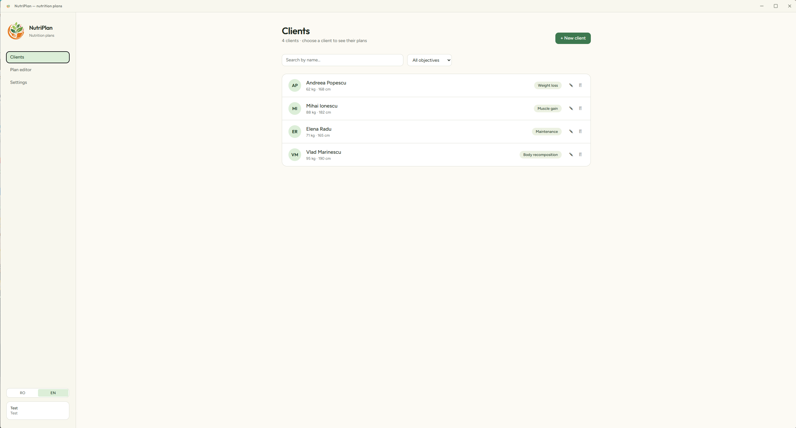
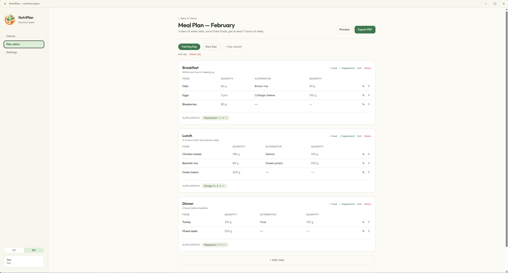
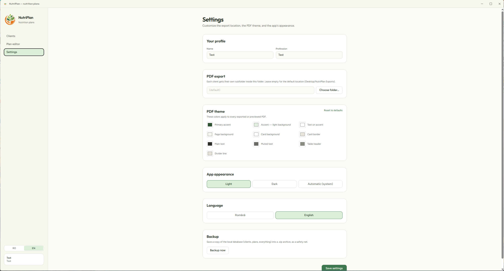

# NutriPlan

A desktop app for nutritionists / personal trainers — manage clients, build meal plans (day variants → meals → foods/supplements), and export them as client-ready PDFs.

Built with [Wails v2](https://wails.io) (Go + native WebView), [Svelte 5](https://svelte.dev) + TypeScript frontend, local SQLite database.

  
  
  

## Features

- **Clients** — full CRUD, search and filter by objective (weight loss, muscle gain, maintenance, recomposition)
- **Meal plans** — hierarchical structure: plan → day variants (training day/rest day/etc.) → meals → foods (with an optional alternative) and supplements
- **Duplicate plan** — instantly copy an existing plan (with every day/meal/food) as a starting point for a new client or a new month, optionally targeting a *different* client than the source
- **PDF export** — generates a professional PDF of the plan, with a fully customizable theme (colors, font) from Settings; each client gets their own export subfolder
- **PDF preview** — renders the plan into a temporary file and opens it directly in the system's default PDF viewer, without touching the final export
- **Settings**:
  - profile (name + profession shown in the sidebar, asked for on first launch)
  - PDF theme (10 customizable colors, with a reset-to-defaults option)
  - export location (native folder-picker dialog)
  - app appearance — light/dark/automatic theme (synced with the OS)
  - language — Romanian/English, applied to both the UI and the labels baked into generated PDFs
  - backup — archives the local database into a timestamped `.zip`
- **Structured logging** — `log/slog`, with file rotation (JSON/text, console/file/both)
- **Environment isolation** — `development`/`testing`/`production` automatically use separate databases and export folders, so test data never mixes with real client data
- **Windows installer** — NSIS-based installer (via `wails build -nsis`), bundling a working default config so a fresh install works out of the box

## Tech stack

| Layer | Technology |
|---|---|
| Backend | Go 1.26, [Wails v2](https://wails.io) |
| Database | SQLite (pure-Go driver, [`modernc.org/sqlite`](https://pkg.go.dev/modernc.org/sqlite), no CGO) |
| Lightweight ORM | [`crud-depot`](https://github.com/ciprianiordache/crud-depot) + [`schema-builder`](https://github.com/ciprianiordache/schema-builder) |
| PDF generation | [`maroto/v2`](https://github.com/johnfercher/maroto) |
| Frontend | Svelte 5 (runes) + TypeScript, Vite, Tailwind CSS v4 |
| Logging | `log/slog` + [`lumberjack`](https://github.com/natefinch/lumberjack) (rotation) |

## Architecture

The backend consistently follows a layered pattern, one package per domain (`client`, `plan`, `day_variant`, `meal`, `food`, `supplement`, `pdf_export`, `settings`):

```
internals/app/<domain>/
  model.go     — domain structs + Request/Response DTOs
  repo.go      — database access (crud-depot)
  service.go   — business logic, validation, logging
  handler.go   — exposed to the frontend via a Wails binding
  errors.go
  *_test.go
```

Cross-cutting packages:
- `internals/database` — SQLite connection, file path resolution
- `internals/generator` — generic PDF generation toolkit (theme, layout), domain-independent
- `internals/logger` — builds the structured logger from config
- `internals/osutil` — opens files/folders in the OS's default application
- `config` — loads `config.yaml`/`.env`, environment isolation

## Running locally

### Requirements

- [Go](https://go.dev) 1.26+
- [Node.js](https://nodejs.org) 22+
- [Wails CLI](https://wails.io/docs/gettingstarted/installation) v2

```bash
go install github.com/wailsapp/wails/v2/cmd/wails@latest
```

### Configuration

Copy/edit `config.yaml` in the project root. On first run, if `config.yaml`/`.env` don't exist, they're generated automatically with default values.

Relevant fields:
```yaml
app:
    environment: development   # development / testing / production — isolates the DB and export folder per environment
database:
    driver: sqlite
    name: nutrition-planner
generator:
    # default PDF theme — overridden by the app's Settings screen, if set
logger:
    output: both                # stdout / file / both
```

### Development

```bash
wails dev
```

Starts a Vite dev server with hot-reload for the frontend, plus the Wails app. The TypeScript bindings for the exposed Go methods (`frontend/wailsjs/go/...`) are regenerated automatically on every start.

### Production build

```bash
wails build
```

Produces the executable in `build/bin/`. **Important:** `config.yaml`/`.env` are not copied next to the executable automatically — see `build.ps1` in the project root for a script that runs `wails build` and copies the config for you.

### Windows installer

```bash
wails build -nsis
```

Requires [NSIS](https://nsis.sourceforge.io/Download) (`makensis` on `PATH`). Produces `build/bin/nutrition-planner-amd64-installer.exe`, which bundles `config.yaml`/`.env` directly so a fresh install has a working configuration from the start. `build.ps1 -Installer` runs this and copies the config for local testing in one step.

Before building a real, distributable installer, double-check `config.yaml`'s `app.debug`/`app.environment` are set to `false`/`production` — the repo's defaults are meant for local development (they auto-open DevTools and use verbose logging).

### Seeding test data

```bash
go run ./cmd/seed
```

Populates the current database (respecting `app.environment`) with sample clients, plans, meals, and foods.

## Testing

**Backend:**
```bash
go build ./...
go vet ./...
go test ./...
```

**Frontend:**
```bash
cd frontend
npm ci
npm run check   # svelte-check (type checking)
npm run build   # production Vite build
```

## Project structure

```
├── app.go                    # wiring: config → DB → repo → service → handler
├── main.go                   # Wails entrypoint
├── config/                   # config.yaml/.env loading
├── internals/
│   ├── app/<domain>/         # one package per domain (see Architecture)
│   ├── database/
│   ├── generator/            # generic PDF toolkit
│   ├── logger/
│   ├── osutil/
│   └── testutil/             # in-memory SQLite database for tests
├── cmd/seed/                 # test data seeding
├── frontend/
│   ├── src/
│   │   ├── lib/               # reusable components + i18n, api, stores
│   │   └── views/              # main screens (Clients, Plan, Settings)
│   └── wailsjs/                # Wails-generated bindings (committed to git)
├── build/windows/installer/    # NSIS installer script
└── build.ps1                   # wails build [-Installer] + config.yaml/.env copy
```

## License

[MIT](LICENSE.md)
